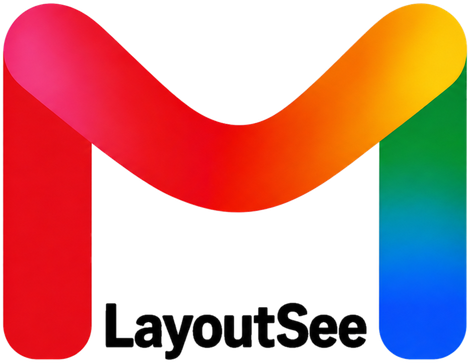
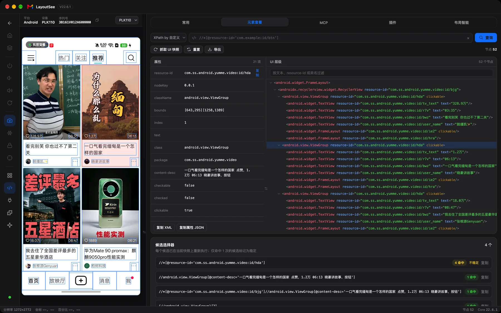
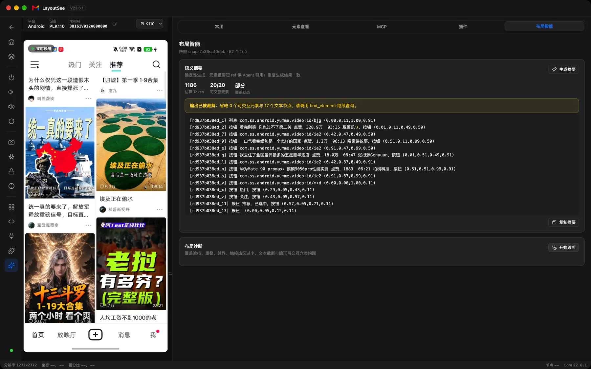
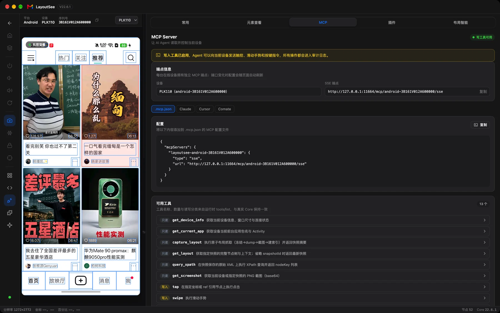
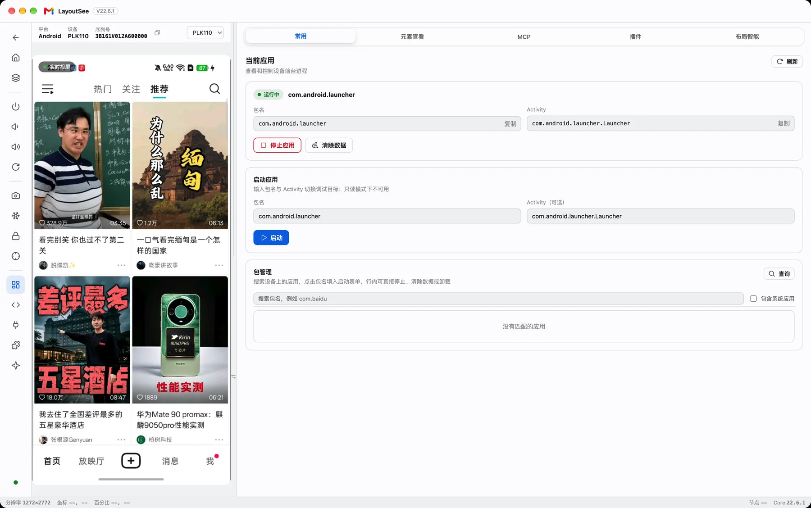
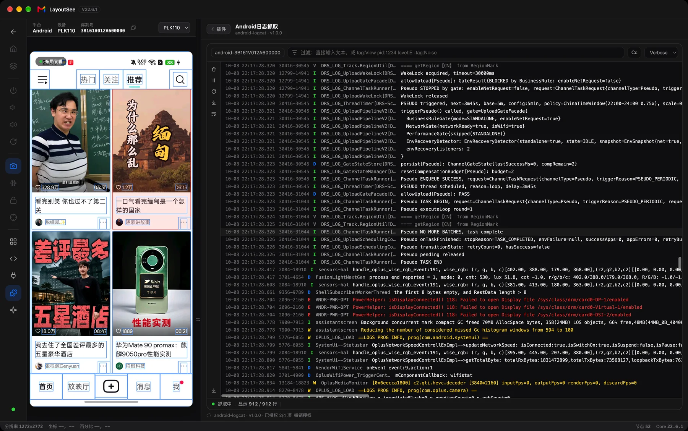

<p align="center">
  <picture>
    <source media="(prefers-color-scheme: dark)" srcset="./assets/readme/logo-dark.png">
    
  </picture>
</p>

<h1 align="center">Give your Agent a sense of UI. And a way to touch it.</h1>

<p align="center">Turn the view tree on a real Android or iOS device into structure your Agent can read, locate and act on.</p>

<p align="center">
  <a href="./README.md">中文</a> · English<br>
  <a href="https://layoutsee-site.vercel.app/">Website</a> · <a href="#get-started">Get started</a> · <a href="#connect-your-agent">Connect your Agent</a> · <a href="#run-from-source">Run from source</a>
</p>

<p align="center">
  
</p>

**Screenshots show your Agent the screen. LayoutSee gives it access to the views behind it.**

LayoutSee is a macOS tool for mobile developers, QA engineers and AI Agents. It exposes the Android and iOS runtime view trees through MCP: what a control is, where it sits, how big it is, who its parent is and whether it is clickable. Your Agent can then tap, swipe and type on the device, connecting its analysis to real actions.

> From “that looks like a button” to “find this control, read its bounds, tap it and verify the next screen.”

## What's new in v22.8.0: your AI can now touch the UI

**As of this release, LayoutSee truly supports both Android and iOS layouts.**

### 📱 iOS layout capture and analysis

Plug in an iPhone and it appears automatically: mirroring, view tree, attribute inspector, log capture and layout diagnostics — the same workbench and MCP tools as Android. Your Agent never needs to care which platform is on the other end: `find_element` always returns the same structured `ref`. iOS capture is strictly read-only.

<p align="center">
  
</p>

### 🤖 Agent capabilities, visible for the first time

A new “Agent” section in Settings shows everything at a glance: live kernel connection status and MCP tool count, plus three bundled Skills — layout-see for layout perception, layout-env for one-shot setup, layout-lookin-server for iOS integration. Every card ships a copyable example prompt: copy, paste, enter — any AI client is ready to go.

<p align="center">
  
</p>

### 👋 A first-launch letter from your AI

A short “let AI read your UI” intro explains what the three Skills do and how to use them. Shown once, never again.

### 🛠️ Environment setup, one sentence

Installing ADB, wiring paths, checking Xcode, debugging simulators — half an hour of pitfalls before. Now hand layout-env to your AI: one sentence, a full health check, ADB path mapped automatically. Want iOS? layout-lookin-server integrates LookinServer into your project, through CocoaPods or SPM.

### 📦 And a lighter download

DMG 136 → 94 MB (arm64), 141 → 104 MB (x64) — nearly a third smaller, not a feature fewer.

## What your Agent gains

1. **Perceive the structure.** Read text, resource IDs, parent–child relationships, bounds and interaction attributes together. Screenshots provide visual context; the view tree provides structural evidence.
2. **Locate a specific control.** Search by text, description, resource ID or XPath. Get a short `ref` that turns “tap Login” into a reference to an element in the current snapshot.
3. **Touch the interface.** Use `tap`, `swipe` and `input_text`, then capture a new snapshot to verify the result. Read-only mode and action logs keep device operations controlled.
4. **Investigate with evidence.** Check for overlap, occlusion, out-of-bounds elements, small touch targets, text truncation and invisible interactive elements. Diagnostics return the nodes involved and measured evidence for further analysis.

## From seeing to acting

**Capture → Read the structure → Locate an element → Act → Verify.**

A snapshot associates the screen, hierarchy, attributes and coordinates with best-effort synchronization. A semantic summary condenses it into an element list with short refs and normalized bounds. Your Agent can read the page structure first, then inspect details without starting from the full XML dump.

<p align="center">
  
</p>

You can inspect the same structure yourself: click the screen to locate a tree node; select a node to highlight its bounds. Attributes, XPath queries and candidate selectors with match counts make controls easy to investigate.

## Get started

Supports **macOS + Android devices/simulators** and **iOS devices/simulators**. iOS requires your app to embed LookinServer in the Debug configuration (see below); HarmonyOS support is on the way.

1. Download a DMG from the [website](https://layoutsee-site.vercel.app/download.html) or [Releases](https://github.com/IQQcode/LayoutSee/releases/latest): choose `arm64` for Apple Silicon or `x64` for Intel. You can also [run from source](#run-from-source). If macOS blocks an unsigned build, select “Open Anyway” in System Settings → Privacy & Security.
2. Enable Developer options and USB debugging, connect the phone using a data-capable USB cable, and approve the debugging prompt on the device.
3. Open the device workbench to control the screen or capture a snapshot and inspect the view tree.

Device access requires `adb`. Set its path in Settings, or install it first:

```bash
brew install android-platform-tools
```

For iOS, no extra command-line tooling is needed: integrate [LookinServer](https://github.com/QMUI/LookinServer) (currently 1.2.8) into your app with the Debug configuration and keep the app in the foreground — it then appears in the device list automatically (simulators need no cable; real devices connect over USB).

### Environment setup in two prompts

Installing ADB, wiring paths, checking Xcode, integrating LookinServer — none of this has to be done by hand. The in-app “Settings → Agent” section ships an example prompt for each bundled Skill; hand them to any AI client (Claude / Cursor / Comate and friends), copy, paste, enter:

**Health check and one-shot setup** (ADB discovery and path mapping, Xcode and simulator runtimes, CocoaPods):

```text
Run a LayoutSee environment check and one-shot setup with layout-env.
```

**iOS integration** (do this once before capturing iOS layouts; embeds LookinServer into your project, CocoaPods or SPM):

```text
Integrate LookinServer into my iOS project with layout-lookin-server.
```

## Connect your Agent

Copy the configuration from the device workbench's **MCP** tab into a client that supports MCP. Each online device has its own endpoint; use the address shown in the app.

<p align="center">
  
</p>

Give your Agent the [`layout-see` Skill](./skills/layout-see/), then describe the task:

- “Read the current page and list clickable elements with their resource IDs.”
- “Check the bottom button's bounds and touch target for evidence of occlusion.”
- “Find and tap the login entry, then capture the page to verify it opened.”
- “Enter a search term and submit it, then inspect the results page structure.”

Your Agent uses the tools it needs:

| Purpose | MCP tools |
| --- | --- |
| Perceive the page | `capture_layout` · `get_layout` · `get_layout_summary` |
| Locate controls | `find_element` · `query_xpath` |
| Check the layout | `diagnose_layout` |
| Act on the device | `tap` · `swipe` · `input_text` |
| Add context | `get_device_info` · `get_current_app` · `get_screenshot` |

12 built-in tools: 9 read, 3 write. Read-only mode blocks writes. After the page changes, capture again and use refs from the new snapshot. Tapping by `ref` uses the center of that node's bounds. See the [Skill tool reference](./skills/layout-see/references/mcp-tools.md) for invocation details.

Environment setup and integration are delegated the same way: [`layout-env`](./skills/layout-env/) runs the health check and one-shot setup, [`layout-lookin-server`](./skills/layout-lookin-server/) embeds LookinServer into your iOS project — see the two prompts under [Get started](#get-started).

## A workbench for developers, too

Screen mirroring and control, view trees and attributes, XPath and selectors, summaries and diagnostics—all in one window. Plugins add log capture, snapshot previews, workbench panels and MCP tools.

<details>
<summary>See the workbench and log plugin</summary>

<p align="center">
  
</p>

<p align="center">
  
</p>

Examples live in [`repos/plugins`](./repos/plugins/). See the [plugin overview](./source/plugins/overview.md) for architecture and extension details (Chinese).

</details>

## Where perception has limits

- **Structure depends on the nodes the device exposes.** WebView and custom Canvas content may hide internal elements. Screenshots can add visual context, but cannot prove internal hierarchy or resource IDs.
- **A snapshot represents one capture.** Capture again if the page changes during collection. Geometry diagnostics provide clues; confirm the cause with screenshots and source code.
- **Device processing runs locally.** The Core listens on loopback by default. Once connected to an external AI client, that client's configuration determines how data is sent.

Snapshot archives and diffs, offline import/export, Windows and team services are still planned. See the [PRD](./docs/feature/UI-LayoutSee需求文档PRD.md) (Chinese).

## Run from source

Requires macOS, Node ≥ 22.12, Python 3.12, `uv` and `adb`.

```bash
git clone https://github.com/IQQcode/LayoutSee.git
cd LayoutSee
npm install
npm run dev:web      # start the local Core and web workbench
```

```bash
npm run test:unit    # unit tests
npm run lint         # static checks
npm run build:all    # contract checks and builds
npm run package:mac  # package the macOS app
```

Find module setup guides in [source/index.md](./source/index.md) and the full workspace map in [docs/repo-structure.md](./docs/repo-structure.md) (Chinese).

## Acknowledgments

Android device access and mirroring build on open-source projects including [uiautomator2](https://github.com/openatx/uiautomator2) and [scrcpy](https://github.com/Genymobile/scrcpy). The device-access layer was adapted from [uiautodev](https://github.com/codeskyblue/uiautodev). iOS layout capture is implemented on top of [LookinServer](https://github.com/QMUI/LookinServer) (MIT).
