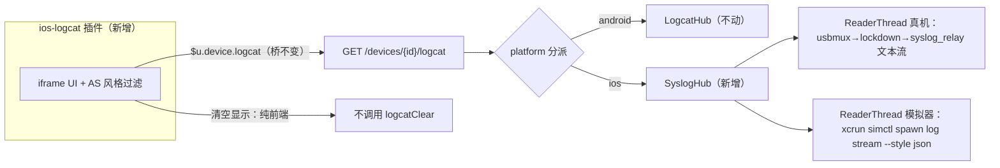

# iOS 日志抓取（syslog）设计文档

| 属性 | 内容 |
| --- | --- |
| 文档状态 | 已确认（2026-11-01，三决策用户已选：写文档 / 真机+模拟器 / 复用 /logcat 端点） |
| 目标版本 | 22.7.0（分支 v22.7.0_dev_ios） |
| 文档用途 | 本次需求的方案事实源，冲突时以本文为准 |

## 背景和目标

用户连接 iOS 测试机后，工作台没有任何日志抓取能力（Android 有 `android-logcat` 插件 + `/devices/{id}/logcat` 增量端点；终端 Tab 也只支持 adb shell，iOS 无 shell 可用）。本需求对标 `adb logcat | grep xxx`，为 iOS 提供带过滤的日志抓取。

目标（可判定）：

1. iOS 真机（USB）与模拟器均可增量读取日志，端点与 Android 同形：`GET /devices/{id}/logcat` 返回 `{lines, cursor, dropped, reset, buffered}`，条目含 `seq` 游标。
2. 新增内置插件 `ios-logcat`（`devicePlatforms: ["ios"]`）：AS 风格过滤表达式（`process:` / `-process:` / `pid:` / `level:` / 裸文本）、级别下拉、暂停继续、清空显示、点行停滚、soft-wrap、导出。
3. Android 日志链路行为零变化；`npm run contracts:check` 无漂移。

## 当前代码库现状

- **Android 链路（不动）**：`logcat.py LogcatHub`（周期 `adb logcat -d` dump + 重叠锚点对齐 → seq 游标增量）← `server.py` `_read_logcat`（GET 只读，无会话）与 `_clear_logcat`（POST 写门禁：会话 + 只读拦截 + 审计）← 桥 `$u.device.logcat / $u.device.logcatClear`（`bridgeHost.js` 白名单 `device.read / device.write`）← `repos/plugins/android-logcat/`。
- **iOS 现状**：`ios/` 包纯 Python socket（usbmux 隧道 + Lookin 协议）；`UsbmuxClient.list_devices/connect` 与 `SimctlClient.booted_udids()` 都是现成积木，但与 `logcat.py` 零交集 → iOS 无日志能力。
- **设备模型**：descriptor `{platform, serial, readonly, status}`；iOS 真机 serial=UDID，模拟器 serial=`simulator:{port}`；`DeviceRegistry.is_readonly` 对 iOS 恒 True。
- 契约：logcat 两端点响应均为通用 `JsonEnvelope`，条目结构未入 schema → 复用端点不触发契约变更。

## 架构和技术设计



核心决策：

1. **复用 `/logcat` 端点与桥**：`server.py` 的 `_read_logcat` / `_clear_logcat` 按 `registry.device(device_id)["platform"]` 分派到 `SyslogHub`；`plugin-runtime.js`、`bridgeHost.js`、契约全部不动。
2. **真机 = lockdown + `com.apple.syslog_relay` 文本流**（纯 socket，零第三方依赖，与 `ios/` 包现状同路线；pymobiledevice3 在 iOS 17 实测该服务经 usbmux lockdown 仍可用）。
3. **模拟器 = `xcrun simctl spawn <udid> log stream --style json --level debug`**（本机实测：json style 带级别 `messageType`、`processImagePath/processID/threadID/eventMessage` 齐全；syslog/compact style 无级别列，故选 json）。顶层 JSON 对象流式提取（深度计数 + 字符串感知），仅 `eventType=="logEvent"` 的条目入列。
4. **条目形状与 Android 完全同构**，`tag` 字段承载 iOS 进程名（插件过滤与 UI 代码近乎零改动复用）：

   ```json
   {"time": "Nov  1 00:07:32", "pid": 53962, "tid": 0, "level": "I",
    "tag": "lsd", "message": "…", "continuation": false, "seq": 42}
   ```

5. **SyslogHub 语义对齐 LogcatHub**：`read(device_id, serial, after, limit)` / `clear(device_id, serial)` 返回同形 dict；区别是 iOS 无「dump」命令，改为**每设备一条持续流读取线程**（懒启动、断流自愈、环形缓冲 4000 条、游标单调递增）。
6. **iOS clear = 本地缓冲重置 + 流重连**（不触碰设备状态）。分派放在 `_clear_logcat` 只读拦截之前：iOS 恒只读铁律针对的是设备注入/修改，本地缓冲清空不属于设备写；照常写审计（`logcat_clear`，allowed）。
7. **插件 UI 的「清空」是纯前端清屏**（`resetBuffer`，保留游标），不调用 `logcatClear`——iOS 恒只读下写按钮照 Android 插件惯例禁用，避免语义误导；「清空显示」按钮不受只读限制。
8. **级别映射**：真机 `<Notice>→I`、`<Info>→I`、`<Warning>→W`、`<Error>→E`、`<Debug>→D`、其余→I；模拟器 `messageType` Default/Info→I、Debug→D、Error→E、Fault→F。iOS 无 V 级，插件级别下拉与 `LEVEL_ORDER` 用 iOS 序（D=0,I=1,W=2,E=3,F=4）。

## 数据流或调用链

真机读取链（后台线程）：

1. `UsbmuxClient` 新开隧道连 lockdown（端口 62078）。
2. lockdown plist 协议（4 字节**大端**长度 + binary plist，区别于 usbmux 头）：`QueryType` → `ReadPairRecord`（usbmuxd 消息，取配对记录）→ `StartSession(HostID)`（响应 `EnableSessionBypass=false` 时对 lockdown 通道用配对证书 TLS）→ `StartService("com.apple.syslog_relay")` → 响应取 `Port`（host 序，直接给 `UsbmuxClient.connect`）与 `EnableServiceSSL`（true 则服务通道用配对证书 TLS）。
3. usbmux connect 新隧道到该端口 → 裸流。
4. 循环读块 → 按 `\n\x00` 分行 → **vis(3) 解码**（`\M-x` / `\M^X` / `\ddd` 八进制 / `\\`，中文日志必经此步否则乱码）→ 行解析 → 环形缓冲。

模拟器读取链（后台线程）：`booted_udids()` 恰好一台 → 严格 UUID 校验后 spawn `log stream --style json --level debug` → 逐字节累积 → 深度计数提取顶层对象 → 字段映射入环形缓冲；进程退出即断流。

插件侧：1s 轮询 `device.logcat(after, limit)`（与 Android 插件相同节奏），`reset` 置位时重置本地缓冲，`dropped` 置位提示丢日志。

## 关键接口与数据结构

```python
# ios/syslog.py（新增，真机客户端 + 双端 Hub）
def decode_vis(line: bytes) -> bytes: ...            # vis(3) 还原，仅高位字节与反斜杠
def parse_relay_line(raw: str, previous) -> dict|None  # 时间16字符+设备名+进程[PID]+<Level>: 消息
def extract_sim_json_objects(buf) -> tuple[list[dict], bytes]  # 顶层对象提取，返回(对象,残余)

class SyslogRelayClient:            # 真机
    def __init__(self, usbmux: UsbmuxClient): ...
    def stream(self, udid: str) -> Iterator[str]      # 打开隧道→迭代解码后的行；断流抛 CoreError

class SyslogHub:                    # 双端
    def __init__(self, relay: SyslogRelayClient, simctl: SimctlClient, max_buffer=4000): ...
    def read(self, device_id, serial, *, after=None, limit=500) -> dict
    def clear(self, device_id, serial) -> dict        # 本地重置；真机额外触发流重连
```

```python
# server.py 分派（伪码）
platform = self.context.registry.device(device_id).get("platform")
if platform == "ios":
    return self.context.syslog.read(device_id, serial, after=cursor, limit=count)
return self._logcat_hub().read(device_id, serial, after=cursor, limit=count)
```

错误码全部复用 `errors.py` 既有码：配对缺失/StartService 被拒/流中断 → `LOOKIN_UNAVAILABLE`；设备不在场 → `IOS_DEVICE_NOT_FOUND`（`serial_for` 既有行为）；多台 booted 模拟器无法定位 → `CORE_UNAVAILABLE`。

## 错误处理、兼容性和边界情况

- **设备拔出**：读线程 EOF → 线程退出；下一次 `read` 重新拉起（自愈，无独立 reap 线程）。设备离线由 DeviceRegistry 5s 轮询标 offline，`serial_for` 抛 `DEVICE_NOT_FOUND`（既有行为）。
- **未配对/拒绝服务**：`LOOKIN_UNAVAILABLE`，消息指引「请先用 Xcode/Finder 配对设备」；插件以错误点 + 提示展示，不崩。
- **环形缓冲滚过**（消费慢于产生）：游标追赶不上的部分丢失，`dropped=true`（与 Android 同义）。
- **`<private>` 脱敏**：os_log 私有内容系统级脱敏，无法绕过，插件空态/提示文案说明。
- **多台 booted 模拟器**：与截图先例一致——报 `CORE_UNAVAILABLE` 提示仅保留一台；0 台时读线程无法启动，read 返回错误。
- **vis 解码安全边界**：只还原高位字节转义（`\M-x`/`\M^X`/`\ddd` 值 ≥0x7F 段）与 `\\`；控制字符转义保留原样，防止日志内容注入终端控制序列。
- **模拟器子进程**：argv 列表化 + UDID 严格 `[0-9A-F-]{36}` 正则校验 + `shell=False`（对齐 `AdbClient.run` 与 `simctl.py` 范式）。
- **Android 零变化**：`/logcat` 分派仅对 platform=="ios" 改道；`LogcatHub`、`adb.py` 不动。
- **Mimosa hook 约束**：lockdown/syslog 全部纯 socket（复用 `ios/usbmux.py`）；无新动态 subprocess（simctl argv 全字面量 + 校验后的 UDID）。

## 测试策略

- **单元测试（零硬件依赖，`repos/core/tests/test_ios_syslog.py` 新增）**：
  - vis 解码：CJK 混排、`\M-`/八进制/`\\` 用例、控制转义保留
  - 真机行解析：标准行 / 续行（堆栈）/ 短行 / 未知级别
  - 模拟器 JSON 提取：本机实测样本（含 eventMessage 含花括号、含 `},{` 文本的对抗样本）、非 logEvent 过滤、messageType 映射
  - SyslogHub：stub 流注入（复用 `socket_factory` 注入思路），断言游标/dropped/reset/buffered、clear 重置、断流自愈后重拉
  - server 分派：`test_ios_capture.py` 补 `GET /devices/{id}/logcat` iOS 用例（stub SyslogHub）+ Android 回归
- **门禁命令**：`npm run test:core`、`npm run lint`、`npm run contracts:check`、`npm run test:web`
- **真机联调**：USB 连 iOS 测试机，插件页验证中文日志可读、过滤生效（最终可视化确认由人负责）
- **模拟器联调**：本机已 boot 一台模拟器（UDID 3249070E-B6EE-48BC-9674-E3C93E1C91CB）复用验证

## 工作项拆分

| 编号 | 端 | 标题 | 内容描述 | 关注文件与目录 | 依赖 |
| --- | --- | --- | --- | --- | --- |
| W1 | 服务端（Core） | iOS 日志链路（lockdown + SyslogHub + 分派） | `ios/lockdown.py`（lockdown 握手 + StartService）、`ios/syslog.py`（vis 解码/行解析/模拟器 JSON 提取/SyslogHub）、`SimctlClient` 扩展 log_stream、`server.py` 分派、`bootstrap.py` 装配、单测 | `repos/core/src/layoutsee_core/{ios/,server.py,bootstrap.py}`、`repos/core/tests/` | 无 |
| W2 | 客户端（插件） | ios-logcat 插件 + 文档回填 | `repos/plugins/ios-logcat/`（manifest/index.html/app.js/style.css，复刻 android-logcat 交互、iOS 级别序与 process: 过滤、清空显示）、`INDEX.md`/`source/plugins/overview.md` 登记、`contracts` 跑门禁 | `repos/plugins/ios-logcat/`、根 `INDEX.md`、`source/plugins/overview.md` | W1 的条目字段约定（tag=进程名） |

## 明确不做

- **os_trace_relay（unified log 二进制协议）**：字段更全但格式复杂且随版本漂移；classic syslog_relay 已满足 AS 式过滤需求。
- **真机历史日志回放**：syslog_relay 仅实时流，历史归档属另一协议族。
- **`<private>` 内容解密**：需要设备端配置 profile，越出本产品边界。
- **MCP 日志工具**：本次交付 HTTP + 插件；MCP 工具（tools/call 形态）如需要另行立项。
- **多台 booted 模拟器的 UDID↔port 精确映射**：报错代替，未来可用 `simctl listports` 类手段补。
- **终端 Tab 的 iOS 化**：iOS 无 shell，终端保持 Android-only。
