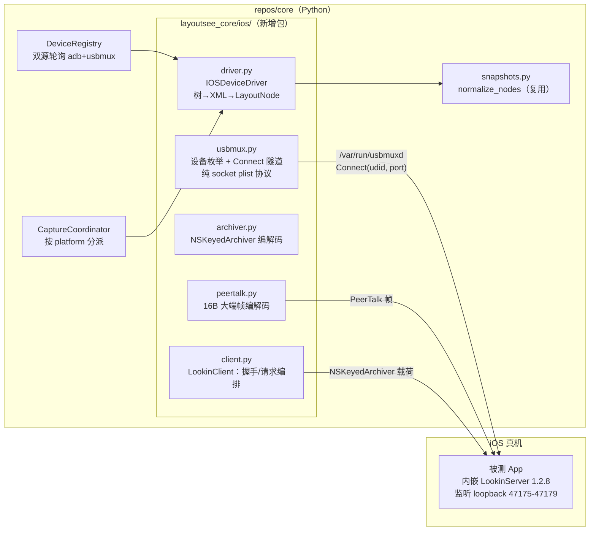

# iOS 接入 Lookin（v22.7.0 第一版）设计文档

| 属性 | 内容 |
| --- | --- |
| 文档状态 | 已确认（2026-10-25 用户评审通过） |
| 目标版本 | v22.7.0（分支 `v22.7.0_dev_ios`） |
| 文档用途 | 本次需求的方案事实源，冲突时以本文为准。调研背景见 `docs/research/ios-lookin-integration.md` |

## 背景和目标

LayoutSee 目前只能抓取 Android 布局（uiautomator 链路），设备页 iOS Tab 是占位面板。本需求基于开源工具 Lookin 内置接入 iOS 布局抓取：**在 Core 内纯 Python 复刻 Lookin 客户端协议**（路线 A），不嵌入 GPL 的 Lookin mac 客户端，不新增原生构建链。

目标（可判定）：

1. USB 连接的 iOS 真机上，被测 App 集成 LookinServer 1.2.8（Debug 构建）后，LayoutSee 设备页出现该设备（platform=ios）。
2. 对 iOS 设备执行抓取，返回与 Android 同构的快照记录（nodes/XML/refs），元素查看、XPath、选择器、摘要、六类诊断全部可用。
3. 无真机时，协议层有合成 fixture 单测 + 诊断脚本可独立验证；真机冒烟作为人工验收项。
4. `npm run contracts:check`、`npm run test:core`、`npm run test:web` 全绿。

明确的产品边界（沿用调研结论）：iOS 只能抓「集成了 LookinServer 的自家 App」（Debug 配置），抓不了任意三方 App；iOS 设备恒为只读（Lookin 无 tap/输入注入能力）。

## 当前代码库现状

- 设备层：`AdbClient`（adb.py）是唯一设备驱动，`DeviceRegistry`（devices.py:62）只轮询 adb，descriptor 的 `deviceId` 硬编码 `android-{serial}`（adb.py:119、devices.py:16）。
- 抓取链：`CaptureCoordinator._capture`（snapshots.py:248）直接调 `adb.dump_xml` + `adb.screenshot`，输出 `normalize_nodes` 后的 LayoutNode + 原始 XML + ET.Element 列表；`xpath.py`/`selectors.py`/`diagnostics.py`/`summary.py`/`finder.py` 全部只消费快照 record，与平台无关。
- 路由层：`server.py` 设备子路由（diagnostics/current-app/apps/screenshot/window-size/logcat）直接调 `context.adb.*`，未按 platform 分派；`POST /devices/{id}/snapshots` 走 `context.capture.capture`（平台无关入口）；`media/capabilities` 是全局单例（scrcpy），不区分设备。
- Web：`DevicesPage` 平台 Tab 骨架已存在，iOS Tab 渲染 `PlatformPlaceholder`；`DeviceCanvas` 已支持「无 screenshot 元数据时只画 wireframe」降级（`screenshot?.contentUrl` 可选链）；`WorkbenchPage.viewMode` 初始恒为 `"live"`，`DeviceCanvas.liveActive` 不检查 platform（iOS 会误开 scrcpy 流）；插件扩展模型 `devicePlatform` 硬编码 `"android"`（WorkbenchPage:155）。
- 契约：`device.json` platform enum 仅 `["android"]`；`npm run contracts:generate` 同步三处生成物（generated/typescript、generated/python、core 的 `generated_contracts.py`），`contracts:check` 做字节级漂移门禁。

## 架构和技术设计



分层职责：

- `usbmux.py`：`UsbmuxClient`，连 `/var/run/usbmuxd`，`list_devices()`（Listen 模式收 DeviceAttached 或 ListDevices）返回 `{udid, device_id}`；`connect(udid, port)` 打开新 socket 发 Connect 消息，成功后返回裸 TCP 流（PeerTalk 帧在此之上）。
- `peertalk.py`：帧编解码。帧头 16 字节 `version(u32)=1 / type(u32) / tag(u32) / payloadSize(u32)`，**全部 htonl 大端**（PTProtocol.m 用 htonl/ntohl 已确认）；`read_frame` / `write_frame`，payload 上限保护（如 512MB）。
- `archiver.py`：NSKeyedArchiver 二进制 plist 的解码（`$top`/`$objects`/`$class` 图 → Python 对象，支持常见Foundation 类与 Lookin 类骨架）与编码（仅需要发出 `LookinConnectionAttachment`）。用标准库 `plistlib` 处理 bplist 容器，自写 keyed-archiver 层。
- `client.py`：`LookinClient(stream)`：`ping()` 校验 `lookinServerVersion ∈ [7,7]`；`app_info()`；`hierarchy()`；`hierarchy_details()`（分批收包：`dataTotalCount/currentDataCount` 聚合，attrGroups 留下、images 丢弃）。请求/响应均为 `LookinConnectionAttachment` 归档载荷，超时 0.5s（App）/5s（其余）。
- `driver.py`：`IOSDeviceDriver`，对 registry/capture 暴露与 AdbClient 同风格接口：`devices()`、`capture(udid) -> {xml, window_size, ...}`。抓取流程：扫端口 47175–47179 → 每个连通端口 ping+app_info → **选 `appIsInBackground=False` 的 App**（前台唯一，天然确定）→ hierarchy + hierarchy_details → 生成 uiautomator 风格 XML。
- 集成：`DeviceRegistry` 增加 `ios` 数据源并行轮询（失败保留上一轮、离线标记逻辑复用）；`CaptureCoordinator` 按 descriptor.platform 分派到 iOS 驱动；`bootstrap.build_core` 装配 iOS 驱动并注入。

## 数据流或调用链

一次 iOS 抓取（`POST /api/v1/devices/{id}/snapshots`）：

1. `server._capture` → `CaptureCoordinator.capture(device_id)`（DeviceGate 串行锁复用）→ `_capture` 发现 descriptor.platform=="ios" → `IOSDeviceDriver.capture(udid)`。
2. usbmux Connect 到该设备 47175–47179 逐端口尝试 → Ping（0.5s 超时）→ 版本校验（server version=7）→ `app_info()`（筛选前台 App，记录 appName/bundleId/screenWidth×scale 等）。
3. `hierarchy()` 拿 `LookinHierarchyInfo.displayItems` 树（frame/bounds/classChainList/alpha/isHidden/backgroundColor）；`hierarchy_details()` 分批补 attrGroups（text、accessibilityIdentifier、hidden、userInteractionEnabled 等；图片数据直接丢弃，不落盘不转发）。
4. `driver` 把树映射为 uiautomator 风格 XML（`<hierarchy><node class bounds text resource-id content-desc enabled clickable .../>`），窗口尺寸取 `screenWidth*screenScale × screenHeight*screenScale`。
5. 回到 `snapshots.py`：生成的 XML 走**同一个** `normalize_nodes`（LayoutNode、refs、ET.Element 全部复用），record 形态与 Android 完全一致；`screenshot=None` + warning「iOS 暂不支持截图，以线框渲染」。
6. Web：`DeviceCanvas` 收到无 screenshot 的快照自动进入纯 wireframe 渲染（既有降级路径，零改动）。

属性映射（表驱动，实现期用真机 fixture 校准，未知属性进 raw 不报错）：

| LayoutNode 字段 | iOS 来源 |
| --- | --- |
| className | `viewObject.classChainList[0]` |
| boundsPx | `item.frame`（点）× screenScale 取整 |
| text | UILabel/UITextView/UITextField 的 text 属性 attr |
| resourceId | accessibilityIdentifier（attr 或 ivarTraces 回落） |
| contentDescription | accessibilityLabel attr |
| visible | `!isHidden && alpha > 0.01` 且 bounds 非空 |
| enabled | UIControl enabled attr / userInteractionEnabled |
| clickable | UIControl 子类 && userInteractionEnabled |
| raw | 全量 attrGroups 平铺（键=attr identifier） |

## 关键接口与数据结构

```python
# usbmux.py
class UsbmuxClient:
    def list_devices(self) -> list[IosDeviceDescriptor]   # {udid, device_id, product_type...}
    @contextmanager
    def connect(self, udid: str, port: int) -> Iterator[socket.socket]

# peertalk.py
PT_HEADER = struct.Struct(">IIII")  # version=1, type, tag, payloadSize
def read_frame(sock) -> tuple[int, int, bytes]     # (type, tag, payload)
def write_frame(sock, type_, tag, payload: bytes) -> None

# client.py
class LookinClient:
    SUPPORTED_SERVER = (7, 7)
    def __init__(self, stream: socket.socket, timeout: float = 5.0): ...
    def ping(self) -> int                     # 返回 serverVersion，区间外抛 LOOKIN_VERSION_MISMATCH
    def app_info(self) -> dict                # appName/bundleId/screenWidth/Height/Scale/osDescription...
    def hierarchy(self) -> HierarchyInfo      # displayItems 树 + appInfo
    def hierarchy_details(self) -> dict[int, list[AttrGroup]]   # oid -> attrGroups（丢弃 images）

# driver.py
class IOSDeviceDriver:
    USB_PORTS = range(47175, 47180)
    def available(self) -> bool               # usbmuxd socket 可连
    def devices(self) -> list[dict]           # descriptor：deviceId="ios-{udid}", platform="ios",
                                              # capabilities=["layout"], readonly=True
    def capture(self, udid: str) -> IOSCapture  # {xml, window_size, app, warnings}
```

Lookin 协议常量（事实源 QMUI/LookinServer @develop，MIT）：请求类型 Ping=200/App=201/Hierarchy=202/HierarchyDetails=203/AllAttrGroups=210；`LOOKIN_SERVER_VERSION=7`；真机端口 47175–47179、模拟器 47164–47169；错误码域 `LookinError`（PingFailForTimeout=-404 等）。

## 错误处理、兼容性和边界情况

- **新错误码**（errors.py + STATUS_BY_CODE）：`IOS_DEVICE_NOT_FOUND`（usbmuxd 无此设备，409）、`LOOKIN_APP_NOT_FOUND`（无端口响应/无前台 App，409，文案引导「确认 App 集成 LookinServer 且处于前台」）、`LOOKIN_VERSION_MISMATCH`（server version ≠7，426，文案提示 LookinServer 1.2.8）、`LOOKIN_UNAVAILABLE`（usbmuxd 不可达，503）。device 门禁逻辑：iOS 设备对所有写路由（actions/shell/logcat clear）在 platform 分派层直接抛 `READ_ONLY_MODE`。
- **server.py 分平台**：`{id}/window-size|screenshot|current-app|diagnostics|logcat|media/*` 对 iOS 设备返回平台化响应或稳定错误；`window-size` 从 iOS 最新快照缓存回（见 W2），`media/capabilities` iOS 返回 `mode="none"`。
- **多 App 并存**：同一设备多个集成 SDK 的 App 各占一个端口；用「ping 通过且 appIsInBackground=False」筛选（iOS 前台 App 唯一，结果确定）。全部后台时返回 `LOOKIN_APP_NOT_FOUND`。
- **属性拉取失败降级**：hierarchy 成功而 details 失败时，仍出快照（text/resourceId 为空、warning 注明）；hierarchy 失败则整体失败。
- **并发**：usbmux Connect 短连接（每次抓取新建，用完即关），不复用长连接，避免与 DeviceGate 锁交叉；App 端 LookinServer 本身支持重复连接。
- **模拟器**：v22.7.0 反馈轮已补——模拟器与主机共享 loopback，`IOSDeviceDriver` 直连 47164–47169 枚举与抓取（无需 usbmuxd）；LookinServer 单客户端，Lookin 官方客户端占用时端口不可达属预期。
- **版本耦合**：客户端常量 pin LookinServer 1.2.8（version=7）；License 约束——仅依据 MIT 仓库理解协议，不复制 GPL mac 客户端代码，`ios/` 包文件头注明协议事实源。

## 测试策略

- **协议层单测**（`tests/test_ios_protocol.py`）：PTFrame 编解码往返与畸形输入；usbmux plist 消息编解码（本地 socket 对拍）；NSKeyedArchiver：用自研 encoder 生成 `LookinConnectionResponseAttachment`（含嵌套 DisplayItem 树）→ 自研 decoder 还原断言，另手工构造一份 bplist 金样 fixture 防编解码同源漂移。跑法：`npm run test:core`。
- **集成单测**（`tests/test_ios_capture.py`）：仿 `test_device_shell.py`——`build_core` 起真实 HTTP server，注入 StubIOSDriver（预置 XML/window_size），断言 `GET /devices` 含 ios 设备、`POST /snapshots` 返回与 Android 同构 record、写路由被 READ_ONLY_MODE 拦截。
- **诊断脚本**（`repos/core/scripts/diagnose_lookin.py`，对齐 diagnose_scrcpy.py 惯例）：`--list`（usbmux 设备）、`--scan`（端口扫描+ping+appInfo）、`--capture`（拉层级输出 JSON+XML），真机冒烟的人工验证入口。
- **门禁**：`npm run contracts:check`（device.json 变更后 generate）、`npm run test:web`（DeviceCanvas 门禁逻辑如有纯函数则补测）。
- **人工验收**（有真机时）：LookinDemo App → `diagnose_lookin.py --scan/--capture` → UI 设备页/元素查看/wireframe 全链路。

## 工作项拆分

- **W1【新增】iOS 协议包与验证工具**：`repos/core/src/layoutsee_core/ios/`（usbmux/peertalk/archiver/client/driver 五模块）+ `tests/test_ios_protocol.py` + `scripts/diagnose_lookin.py`。验收：`npm run test:core` 全绿；`python -m layoutsee_core.scripts... diagnose_lookin.py --list` 在无设备时优雅输出空列表。
- **W2【改造】Core 集成**：devices.py（双源轮询）、snapshots.py（分平台 capture）、bootstrap.py（装配）、server.py（window-size/media/diagnostics 等 iOS 分派 + 写路由只读拦截）、errors.py（4 个新错误码）+ `tests/test_ios_capture.py`。验收：集成单测全绿，Android 链路回归不受影响。
- **W3【改造】契约同步**：`device.json` platform enum + `"ios"`、capabilities 增补语义（新增 `"wireframe"`?——不加，复用 `layout`）；`npm run contracts:generate` 同步三处生成物。验收：`npm run contracts:check` 通过。
- **W4【改造】Web 最小支持**：DevicesPage（iOS Tab 渲染真实设备表 + 空态 LookinServer 集成引导 + 行内平台列按 device.platform 渲染）；WorkbenchPage（iOS 默认 snapshot 视图、隐藏 common Tab、插件扩展模型传真实 device.platform）；DeviceCanvas（liveActive 增加 `platform==="android"` 门禁）。验收：`npm run test:web` 全绿；浏览器联调 iOS 设备可见、抓取出 wireframe。

依赖顺序：W1 → W2 → W3 → W4（W3 可与 W2 并行；提交信息前缀带编号）。

## 明确不做

- 不做 iOS 实时投屏（无 scrcpy 等价物，快照 wireframe 即可）；不做截图（后续可用 pymobiledevice3 补）。
- 不做 tap/输入注入/包管理/终端/日志（Lookin 无此能力或属 adb 链路），iOS 恒只读。
- 不做属性修改（Lookin AttrModification 能力）、3D 视图、模拟器支持、MCP 工具的 iOS 专属扩展。
- 不集成 Lookin mac 客户端代码（GPL-3.0），不引入任何原生依赖。
